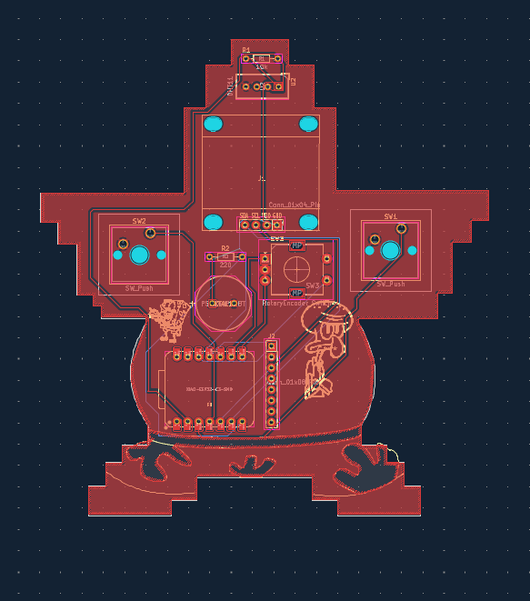
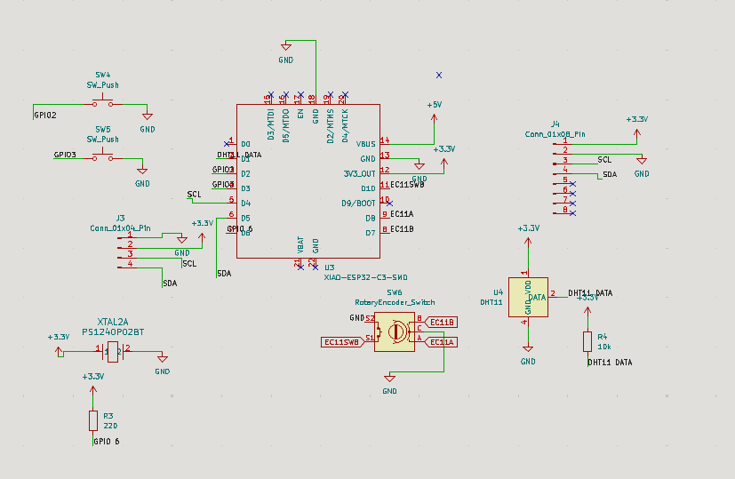
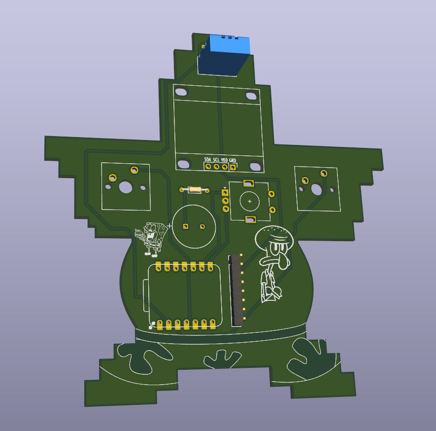

# Starbie

## Introduction:

This is my Patrick Star Starbie for the Hackclub Half Life challenge. It's a desktop pet that can interact with the user. I learned a lot doing this project as it was my first time designing a PCB. 

## Firmware:

Patrick Star will have different emotional states, which will change when the user interacts with him. 
If you leave Patrick Star alone for too long he will progressively become sad. 

## How to flash the firmware:

1. Download the code which will soon be in this repo.
2. Download the Arduino IDE.
3. Open File → Preferences. In Additional Boards Manager URLs, add:

https://espressif.github.io/arduino-esp32/package_esp32_index.json

4. Open Tools → Board → Boards Manager, search for esp32, and install esp32 by Espressif Systems.
5. Under Tools → Board → esp32, select XIAO_ESP32C3.
6. Open Sketch → Include Library → Manage Libraries. Install these libraries one at a time:

-Adafruit GFX Library
-Adafruit SSD1306
-Adafruit MPU6050
-DHT sensor library
If Arduino asks to install dependencies, choose Install All.

7. Connect the Patrick Star Starbie to your pc and flash the code.

## PCB picture:

## Schematic picture:

## Picture from a render of the PCB:

## Picture of a drawing for the face of the Starbie:

## Bill of Materials

## Bill of Materials (BOM)

| Qty | Item  | Cost (ea.) (€) | Link |
|---:|---|---:|---|
| 1 | 0.96" OLED |  2.49 | [AliExpress](https://de.aliexpress.com/item/1005007475013244.html?spm=a2g0o.productlist.main.1.6d2014c3TzMwfG&algo_pvid=b96e7c29-bb73-43d6-8ad9-56e24584bb3a&algo_exp_id=b96e7c29-bb73-43d6-8ad9-56e24584bb3a-0&pdp_ext_f=%7B%22order%22%3A%22301%22%2C%22eval%22%3A%221%22%2C%22fromPage%22%3A%22search%22%7D&pdp_npi=6%40dis%21EUR%212.51%212.49%21%21%2118.18%2118.03%21%40210398e917931961607873221e0ccd%2112000040902623417%21sea%21DE%218427292374%21ABX%211%210%21n_tag%3A-29910%3Bd%3Aaf2815fb%3Bm03_new_user%3A-29895&curPageLogUid=0JzHXNCRZCjm&utparam-url=scene%3Asearch%7Cquery_from%3A%7Cx_object_id%3A1005007475013244%7C_p_origin_prod%3A) |
| 1 | MPU6050 | 2.15 | [AliExpress](https://de.aliexpress.com/item/1005009925487659.html?spm=a2g0o.productlist.main.2.75f215f9KceZsF&algo_pvid=6fdad029-dce3-4cbe-8554-f53b04c18259&algo_exp_id=6fdad029-dce3-4cbe-8554-f53b04c18259-1&pdp_ext_f=%7B%22order%22%3A%2296%22%2C%22eval%22%3A%221%22%2C%22fromPage%22%3A%22search%22%7D&pdp_npi=6%40dis%21EUR%212.15%212.15%21%21%2115.57%2115.57%21%400b88ad2b17931962859502002e0d3c%2112000050595570254%21sea%21DE%218427292374%21ABX%211%210%21n_tag%3A-29910%3Bd%3Aaf2815fb%3Bm03_new_user%3A-29895&curPageLogUid=cu7F5WUZFwko&utparam-url=scene%3Asearch%7Cquery_from%3A%7Cx_object_id%3A1005009925487659%7C_p_origin_prod%3A) |
| 1 | 220 Ω Resistor |  0.18 | [AliExpress](https://de.aliexpress.com/item/1005011886443911.html?spm=a2g0o.productlist.seoads.1.1e2c4710u1212S&p4p_pvid=202610280705232452802854227200000752280_1&gatewayAdapt=glo2deu) |
| 1 | 10 kΩ Resistor |  0.12 | [AliExpress](https://de.aliexpress.com/item/1005011886443911.html?spm=a2g0o.productlist.seoads.1.1e2c4710u1212S&p4p_pvid=202610280705232452802854227200000752280_1&gatewayAdapt=glo2deu) |
| 2 | MX Switches |  0.59 | [AliExpress](https://de.aliexpress.com/item/1005008089864080.html?spm=a2g0o.productlist.main.5.5f5726b3voFLSQ&algo_pvid=8267b3ce-ddf8-4c52-89a3-403fe741ac14&algo_exp_id=8267b3ce-ddf8-4c52-89a3-403fe741ac14-4&pdp_ext_f=%7B%22order%22%3A%22234%22%2C%22eval%22%3A%221%22%2C%22fromPage%22%3A%22search%22%7D&pdp_npi=6%40dis%21EUR%212.99%212.99%21%21%2121.65%2121.65%21%40210382de17931964906297733e0e7a%2112000045838677521%21sea%21DE%218427292374%21ABX%211%210%21n_tag%3A-29910%3Bd%3Aaf2815fb%3Bm03_new_user%3A-29895&curPageLogUid=SBpjzuD7hhLL&utparam-url=scene%3Asearch%7Cquery_from%3A%7Cx_object_id%3A1005008089864080%7C_p_origin_prod%3A) |
| 1 | EC11E Rotary Encoder | 1.59 | [AliExpress](https://de.aliexpress.com/item/1005007943273440.html?spm=a2g0o.productlist.main.2.3e352854TYahRC&algo_pvid=362d8240-3916-4fa6-bdb1-5f0cd205c7fd&algo_exp_id=362d8240-3916-4fa6-bdb1-5f0cd205c7fd-1&pdp_ext_f=%7B%22order%22%3A%2288%22%2C%22eval%22%3A%221%22%2C%22fromPage%22%3A%22search%22%7D&pdp_npi=6%40dis%21EUR%211.61%211.59%21%21%2111.64%2111.52%21%400b15834017931965231023985e0c30%2112000042956357427%21sea%21DE%218427292374%21ABX%211%210%21n_tag%3A-29910%3Bd%3Aaf2815fb%3Bm03_new_user%3A-29895&curPageLogUid=u6MvxcbNVg3o&utparam-url=scene%3Asearch%7Cquery_from%3A%7Cx_object_id%3A1005007943273440%7C_p_origin_prod%3A) |
| 1 | XIAO ESP32-C3 | 6.79 | [AliExpress](https://de.aliexpress.com/item/1005008791664713.html?spm=a2g0o.productlist.main.3.30005505pPruuk&algo_pvid=92206ada-f1b0-413d-841b-35a86a931050&algo_exp_id=92206ada-f1b0-413d-841b-35a86a931050-2&pdp_ext_f=%7B%22order%22%3A%22448%22%2C%22spu_best_type%22%3A%22price%22%2C%22eval%22%3A%221%22%2C%22fromPage%22%3A%22search%22%7D&pdp_npi=6%40dis%21EUR%216.82%216.79%21%21%217.41%217.37%21%400b15831117931966898396804e0e5e%2112000046678458240%21sea%21DE%218427292374%21ABX%211%210%21n_tag%3A-29910%3Bd%3Aaf2815fb%3Bm03_new_user%3A-29895&curPageLogUid=czxJjWamX9rY&utparam-url=scene%3Asearch%7Cquery_from%3A%7Cx_object_id%3A1005008791664713%7C_p_origin_prod%3A) |
| 1 | DHT11 | 0.81 | [AliExpress](https://de.aliexpress.com/item/1005012263106656.html?spm=a2g0o.productlist.main.4.317233bb8PGG5t&aem_p4p_detail=2026102807094916533218519186180000795316&algo_pvid=b15d7c45-9a97-4939-a3b2-d946b97b6013&algo_exp_id=b15d7c45-9a97-4939-a3b2-d946b97b6013-3&pdp_ext_f=%7B%22order%22%3A%2273%22%2C%22eval%22%3A%221%22%2C%22fromPage%22%3A%22search%22%7D&pdp_npi=6%40dis%21EUR%210.81%210.81%21%21%215.88%215.88%21%400b15831117931965899034786e0db9%2112000057911460838%21sea%21DE%218427292374%21ABX%211%210%21n_tag%3A-29910%3Bd%3Aaf2815fb%3Bm03_new_user%3A-29895&curPageLogUid=yzPnKeN2s9ud&utparam-url=scene%3Asearch%7Cquery_from%3A%7Cx_object_id%3A1005012263106656%7C_p_origin_prod%3A&search_p4p_id=2026102807094916533218519186180000795316_1) |
| 1 | Buzzer  | 0.18 | [AliExpress](https://de.aliexpress.com/item/1005007274812383.html?spm=a2g0o.productlist.main.3.29336836oNOM0O&algo_pvid=c6c6338f-83eb-40f7-8122-7b515315e1f6&algo_exp_id=c6c6338f-83eb-40f7-8122-7b515315e1f6-2&pdp_ext_f=%7B%22order%22%3A%221484%22%2C%22spu_best_type%22%3A%22price%22%2C%22eval%22%3A%221%22%2C%22fromPage%22%3A%22search%22%7D&pdp_npi=6%40dis%21EUR%215.44%211.79%21%21%2139.39%2112.98%21%400b884a9917931966218307045e0dd7%2112000040029049663%21sea%21DE%218427292374%21ABX%211%210%21n_tag%3A-29910%3Bd%3Aaf2815fb%3Bm03_new_user%3A-29895&curPageLogUid=CHnwAKqXDZEr&utparam-url=scene%3Asearch%7Cquery_from%3A%7Cx_object_id%3A1005007274812383%7C_p_origin_prod%3A) |
| 1 | PCB  | 10.00 | [JLCPCB](https://www.jlcpcb.com/) |
| | **Total (per kit)** | | **24.9** | |
